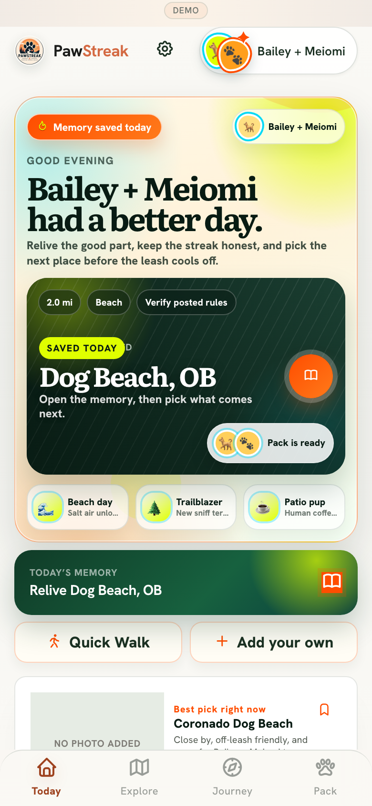
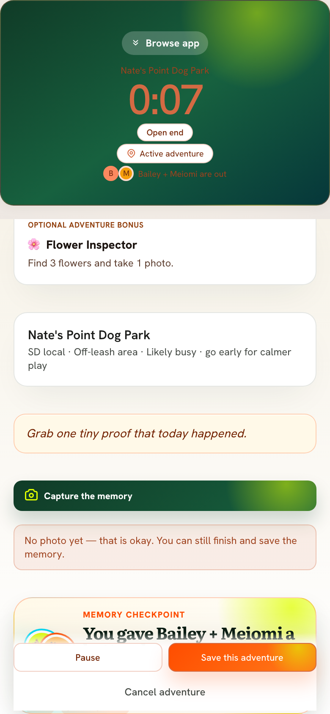

# PawStreak mobile design evidence — November 3, 2026

**Evidence boundary.** Connected browser access failed: `Browser access requires the originating browser context`. No fresh authenticated screenshot, production visual audit, real-device run, or native build was obtained. I **visually inspected the tracked October 31 running-app DEMO captures** (390 × 844, source commit `02dd7f85`) using the connected repository's binary image data. These screenshots show the app demo *at that capture commit*, not necessarily the current deployed UI. No stock, reconstructed or speculative screenshots are included.

## Screenshot-backed findings (ranked)

| Priority | Surface & authentic capture | Observed in the archived capture | Action and release guard |
| --- | --- | --- | --- |
| P0 verify | [Adventure completion](../social-assets/screenshots/06-save-memory-payoff.png) | The fixed Pause / Save action row overlaps the visible beginning of the **Memory checkpoint** panel in the captured scroll position. Some text in the dark green timer area also looks low-contrast. | Verify that the checkpoint and finish CTA remain fully reachable above the native safe area on iPhone SE and Android small screens. Adjust bottom scroll padding and text contrast only after reproducing. Do not alter duplicate-completion safety. |
| P1 | [Home](../social-assets/screenshots/01-adventure-launch-home.png) | A very tall memory/hero panel occupies most of the first fold; three earned-badge subtitles truncate; the next destination image says **NO PHOTO ADDED**. Bailey + Meiomi are visibly included. | Prioritize one clear next-adventure action and meaningful saved plans, without changing established navigation. The concrete saved-plan data fix is PR #62. Audit the first fold again on a live device before tightening hero heights. |
| P1 | [Explore](../social-assets/screenshots/03-discover-adventure-mode.png) and [destination briefing](../social-assets/screenshots/04-adventure-detail.png) | Bold category/place information and Start CTA are present, but an oversized dark hero contains only **NO PHOTO ADDED**. Adventure rules appear below, and map discovery is further down. | Replace **blank-looking placeholders** with approved category illustrations or explicit factual text treatment—not random stock photos or imagery misrepresented as the actual destination. Preserve current rules caveats and real place IDs. |
| P1 | [Adventure ready](../social-assets/screenshots/05-adventure-ready.png) | Correct selected pack and no-timer-until-start messaging are clear. The preview image is missing and the split hero looks unfinished. | Improve the intentional empty-image visual treatment using approved design assets; keep the optional challenge truly optional. |
| P2 | [Saved-memory share preview](../social-assets/screenshots/07-journey-memory.png) | Share modal uses an authentic saved-demo result with **0 photos**, real duration and Journey status. The core memory is legible but the secondary instructions are small. | Preserve true zero-photo completion. Check real-device share-sheet wording, scale and safe-area controls before further polish. Do not imply automatic Instagram publishing. |

### Visual evidence thumbnails — original tracked screenshots

## Screen coverage and evidence status

| Requested area | Current evidence | Limitation |
| --- | --- | --- |
| Home | Visual DEMO capture + `src/screens/app/HomeScreen.tsx`, `src/lib/homeUpcoming.ts` | Current production not photographed |
| Plan / discovery | Visual Explore and destination captures + `src/screens/app/PlanScreen.tsx` | Map and filtering below fold not freshly tested |
| Journey | Visual share-memory DEMO capture + `src/screens/app/JourneyScreen.tsx` | Full Journey timeline not captured |
| Challenges | Code exists in `src/screens/app/MilestonesScreen.tsx` and challenge path components | No visual evidence today |
| Achievements / rewards | `src/screens/app/AchievementsScreen.tsx` and related achievement components checked | No visual evidence today; don't claim badge UI appearance |
| Onboarding | `src/screens/onboarding/OnboardingFlow.tsx` exists | No visual evidence today |
| Maps | `src/components/PlanAdventureMap.tsx` and `src/components/GeographicMap.tsx` exist | No current tiles, permissions or route screenshots |
| Adventure completion | Visual DEMO capture with photo-optional memory path | Native camera, background and server persistence untested |
| Two-dog support | Bailey + Meiomi visible in Home, Explore, ready, completion, and share captures | Other dog-selection combinations require device test |

## Verified-in-repository native foundations, not built artifacts

- `package.json`: Capacitor 8 runtime/plugins, native sync/build helper scripts and QA.
- `capacitor.config.json`: `com.pawstreak.app` and `dist`.
- iOS `Info.plist` and Android `AndroidManifest.xml`: camera/photo/location/deep-link declarations are present.
- `src/lib/nativeDeepLinks.ts`: warm and cold native launch URL path; `src/lib/nativePhotos.ts` and `nativePhotoRestore.ts`: camera/photo restore paths.
- `docs/native-capacitor-launch.md`: explicit remaining signing, Google OAuth, APNs/FCM, Supabase redirects and real-device QA requirements.

**Unverified:** `npm run build`, Xcode archive, Android Gradle assemble, TestFlight/internal track, photo/gallery persistence, installed PWA, real location/map tiles, native share sheet, push-token delivery. A successful static/source audit is not a native build.

## Implementation order

1. **Now / PR #62:** Give user-created planned outings priority on Home over generic reminders; show selected dogs and honest local dates. Regression tests are included; live layout remains to verify.
2. **Next visual gate:** Reproduce the screenshot-observed completion/footer occlusion and contrast issue at 390 × 844 plus small-device safe areas; fix without touching finish/save semantics.
3. **Next brand gate:** Build a cohesive approved category illustration fallback for places with no verified photography, then refine Home/Explore layout against new actual screenshots.
4. **Next native gate:** Run CI/build, then one iPhone and Android acceptance path end to end (auth → choose → start → finish → save photo/memory → Journey). Hold App Store readiness claims until real device evidence exists.

No deployment, publication, catalog changes, user data access, or new artwork was performed by this audit.
